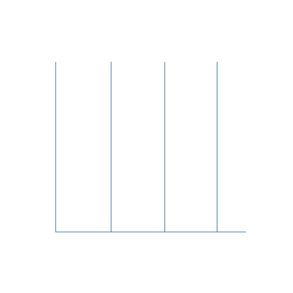

# <b>Hi there, I'm </b><a href="https://github.com/Adityasingh909">Aditya Singh</a> 👋

### Full Stack Developer • AI Explorer • Problem Solver

&nbsp;**_About Me_**

<table align="center" border="0" cellspacing="0" cellpadding="0">
<tr border="0">

<td border="0">

</td>

<td border="0">

</td>

<td border="0">

</td>

<td border="0">

</td>

<td border="0">

</td>

<td border="0">

</td>

<td border="0">

</td>

<td border="0">

</td>

</tr>
</table>

💻 <b>I'm Aditya Singh</b>, a <b>B.Tech Computer Science & Engineering student at KIET Group of Institutions</b> passionate about crafting <b>scalable web applications</b>, <b>AI-powered solutions</b>, and modern developer tooling.

⚡ I primarily work with <b>React</b>, <b>Node.js</b>, <b>Express.js</b>, <b>MongoDB</b>, <b>TypeScript/JavaScript</b>, <b>Python</b>, and <b>C++</b>, turning conceptual ideas into high-performing full-stack products with sleek user interfaces and efficient backend architectures.

🚀 My areas of focus include <b>Full-Stack Web Architecture</b>, <b>Generative AI & LLM Integrations</b>, <b>Cloud & DevOps Workflows</b>, and <b>System Design</b>.

🏗️ Some of my key projects include:
- 🎓 <b>CampusHub</b>: An interactive campus and learning management system for streamlined academic workflows.
- 🤝 <b>stackmate</b>: A collaborative peer platform designed for college students to find the ideal coding partners.
- ✅ <b>Taskly</b>: A full-stack productivity & task workflow app built with clean decoupled client-server architecture.
- 🗣️ <b>Vocalize</b>: Real-time speech transcription & multilingual voice-to-text platform.
- 📚 <b>CS-Fundamentals</b>: Curated placement preparation resources covering DSA, OS, DBMS, Networks, and OOPs.

<h3>🎯 Currently Focused On</h3>

<ul>
  <li>⚡ Building production-ready <b>Full Stack & AI-powered applications</b></li>
  <li>🧠 Advancing <b>Data Structures, Algorithms & competitive problem solving</b></li>
  <li>🚀 Exploring <b>DevOps, Docker, CI/CD pipelines & Cloud deployment</b></li>
  <li>🌍 Contributing to <b>Open Source</b> and student developer communities</li>
</ul>

✨ I believe in learning by shipping real projects, diving into modern technologies, and continuously refining both design and engineering practices.

 

  

&nbsp;**_Tech Stack_**

<table align="center">
    <tr>
        <td align="center" width="90"> JavaScript</td>
        <td align="center" width="90"> TypeScript</td>
        <td align="center" width="90"> Python</td>
        <td align="center" width="90"> C / C++</td>
        <td align="center" width="90"> Java</td>
        <td align="center" width="90"> React</td>
        <td align="center" width="90"> Vite</td>
        <td align="center" width="90"> Node.js</td>
        <td align="center" width="90"> Express.js</td>
    </tr>
    <tr>
        <td align="center" width="90"> MongoDB</td>
        <td align="center" width="90"> PostgreSQL</td>
        <td align="center" width="90"> MySQL</td>
        <td align="center" width="90"> HTML5</td>
        <td align="center" width="90"> CSS3</td>
        <td align="center" width="90"> Git</td>
        <td align="center" width="90"> GitHub</td>
        <td align="center" width="90"> Docker</td>
        <td align="center" width="90"> Postman</td>
    </tr>
</table>

&nbsp; <b>Github Statistics</b>

 

<table width="100%">
<tr>

<td align="left" width="50%">

</td>

<td align="right" width="50%">

</td>

</tr>
</table>

  

